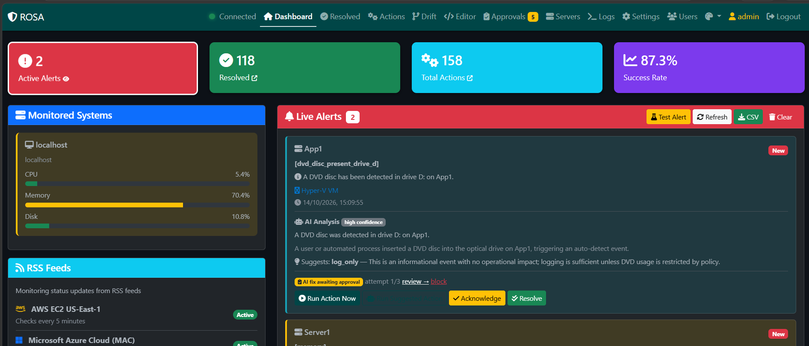
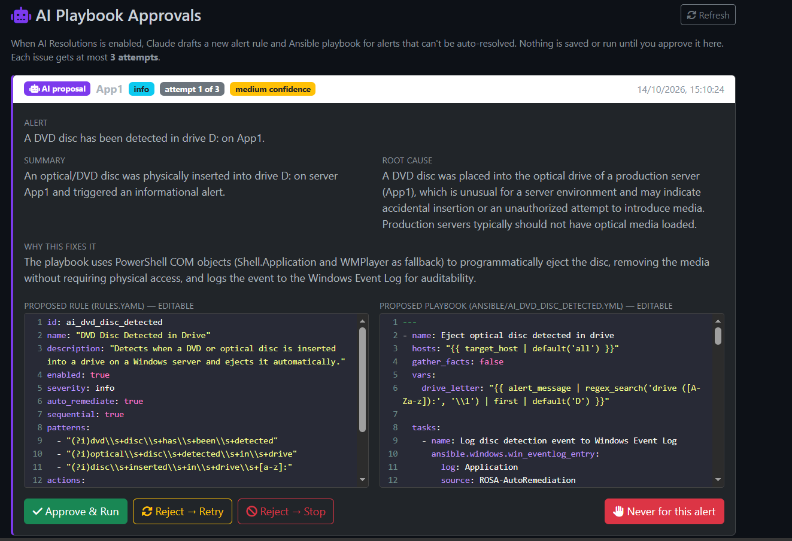
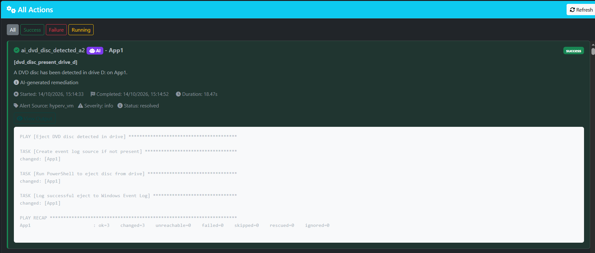
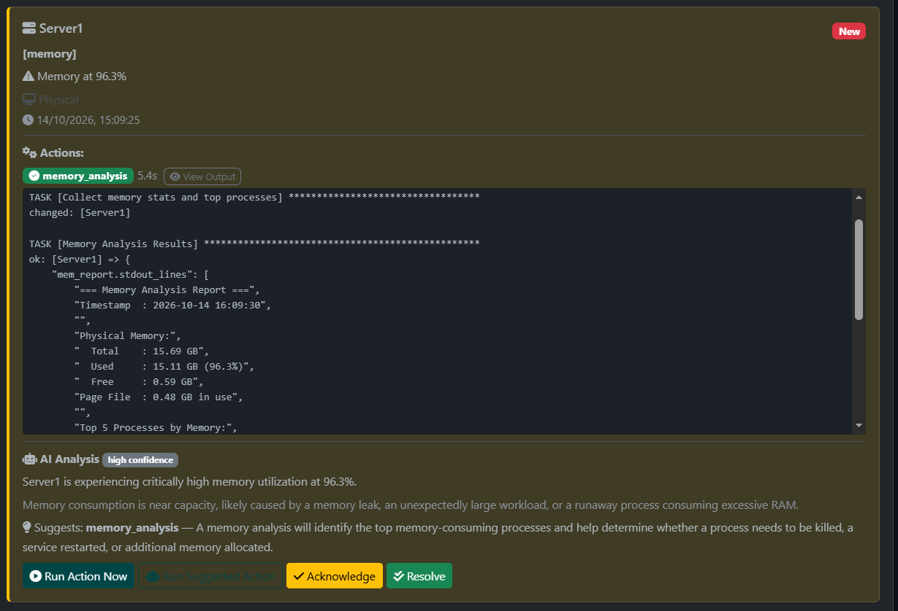

# ROSA - Remediation Orchestration System Administration

- **Author**:        Gavin Mccollin
- **Description**:   Self-hosted IT auto-remediation dashboard — watches alerts, runs Ansible playbooks automatically, and drafts fixes with AI for anything it hasn't seen before
- **Version**:       1.0.2

## Introduction

ROSA closes the loop between an alert firing and the fix actually happening. It watches your Windows infrastructure, matches incoming alerts against a rule engine, and runs Ansible playbooks to remediate — no ticket, no human in the loop, for the issues it already knows how to handle.

- Real-time visibility into every alert and remediation as it happens
- Auto-remediation for known problems — disk cleanup, CPU/memory analysis, service restarts
- An AI layer that drafts a fix for alerts nothing matches, with its reasoning and a confidence score, queued for your approval
- A full audit trail of every action taken, so nothing runs invisibly
- Configuration drift detection across every managed server

## How It Works

1. **An alert fires** — from Prometheus/Alertmanager, Slack, RSS, or the VM Monitor
2. **The rule engine checks it** against `rules.yaml`
   - **Match found** → the matching Ansible playbook runs automatically, result logged on the Actions page
   - **No match** → (if AI Resolutions is enabled) the AI drafts a new rule + playbook and queues it for approval instead
3. **You approve or reject** any AI proposal on the Approvals page — nothing AI-drafted runs without a human clicking Approve & Run
4. **Approved fixes become permanent rules** — saved straight into `rules.yaml` and `ansible/`, so the next alert of that type is handled by the rule engine directly, no AI call needed

## Dashboard

## Features

- **Alert ingestion** — Prometheus/Alertmanager, Slack, RSS feeds, or ROSA's own lightweight agent-free VM monitor
- **Rule-based auto-remediation** — YAML rule engine + Ansible playbooks, fully editable
- **AI Resolutions (opt-in)** — when no rule matches, the AI proposes a new rule + playbook; every proposal is queued on the Approvals page and capped at 3 attempts per issue — it never runs an unapproved AI fix
- **Configuration drift detection** — flags changes you didn't make, across every server
- **Full audit trail** — every action logged, AI-run actions clearly badged
- **Real-time dashboard** — live alert feed over WebSocket, light/dark theme, accent colors

## AI Resolutions

When a rule-free alert comes in, something ROSA has genuinely never seen before. The AI drafts a new rule and a new Ansible playbook for it. Also explains its root-cause reasoning, and scores its own confidence. Nothing is saved or run until a human clicks **Approve & Run** on the Approvals page. Note both the rule and the playbook are fully editable right there before you approve them.

**Capped at 3 attempts, by design.** Each distinct issue (a host + a normalised alert signature) gets at most 3 AI attempts. This isn't just a safety limit it keeps token spend in check. The AI is never asked to re-think the same recurring problem on every single occurrence, only up to 3 times total. After 3 failed/rejected attempts, ROSA raises a critical alert for manual intervention instead of continuing to spend API calls on something it can't solve.

**Loop free and cheaper over time, not more expensive.** The moment a proposal is approved, the rule is written straight into rules and  playbook. Every *future* alert matching that same pattern is now handled by the ordinary rule engine. Meaning no AI call, no token spend, no approval needed. In other words, AI Resolutions only ever pays the "thinking" cost once per problem after that, it's a normal auto-remediation rule like any other.

**Every AI touch is clearly tagged**, so you always know what came from a human and what came from AI:
- AI-authored rules are named with an **`[AI]`** prefix and carry `ai_generated: true` in `rules.yaml`
- AI-authored playbook files get an `AI-GENERATED` header comment (who approved it, when, which issue)
- AI-run actions show a purple **AI** badge on the Dashboard and Actions pages — nothing AI-driven ever blends in with hand-written rules

## Safety

ROSA runs automated actions on production infrastructure, so safety is built in at multiple layers, not bolted on:

- **WhatIf / dry-run mode** — simulate every remediation action without executing it: no files deleted, no processes killed, no configs touched. Reports show exactly what *would* happen before you ever flip it to live.
- **Safe Mode disk cleanup** — only ever touches temp files, the recycle bin, and logs older than 30 days (configurable). It doesn't take arbitrary cleanup actions on a drive.
- **Approval gates on risky actions** — service restarts and process kills require explicit approval by default, even outside the AI flow.
- **AI proposals always require human approval** — see AI Resolutions above; the AI never runs code it wrote without a human clicking Approve & Run, and it's capped at 3 attempts per issue.
- **Encrypted credentials at rest** — server passwords are Ansible-Vault encrypted, never stored in plaintext; the app's own secret key is encrypted at rest (DPAPI) after first run.
- **Full audit trail** — every action taken, by a rule or by AI, is logged and visible on the Actions page.

## Requirements

- **Core app** — Windows 10/11 or Windows Server, no other dependencies (the installer bundles its own runtime)
- **VM Monitor** (optional, for agent-free server polling) — requires WSL2 with Ansible installed; without it, VM Monitor fails silently in the UI (check the logs)
- **Alertmanager ingestion** (optional) — requires an existing Prometheus + Alertmanager setup elsewhere, pointed at ROSA's webhook (Settings → Prometheus/Alertmanager)
- **AI Resolutions** (optional) — requires an API key for the AI provider, entered under Settings → AI Integration

## Download

Grab the latest installer from the [Releases](../../releases) page: `ROSA-Setup.msi`.

1. Run the installer (Windows)
2. Open `http://localhost:5001`
3. Log in with `admin` / `changeme`
4. **Change the default password immediately** under Settings

## Licensing

**Early release — this is actively being tested.** Free tier is currently capped at 3 monitored servers while in this stage. 

Feedback, bug reports, and feature requests are very welcome! — [open an issue](../../issues).

Need more servers? A license key unlocks higher caps — see Settings → License.

## Release Notes

- **v1.0.2** / 2026-10-14
  - Fixed a crash in the VM Monitor scheduler (app context error) introduced in v1.0.1
- **v1.0.1** / 2026-10-14
  - VM Monitor now automatically takes over alert collection whenever Alertmanager is disabled in Settings
- **v1.0.0** / 2026-10-13
  - First public release

## Support

Open an [issue](../../issues) for bugs or feature requests.
